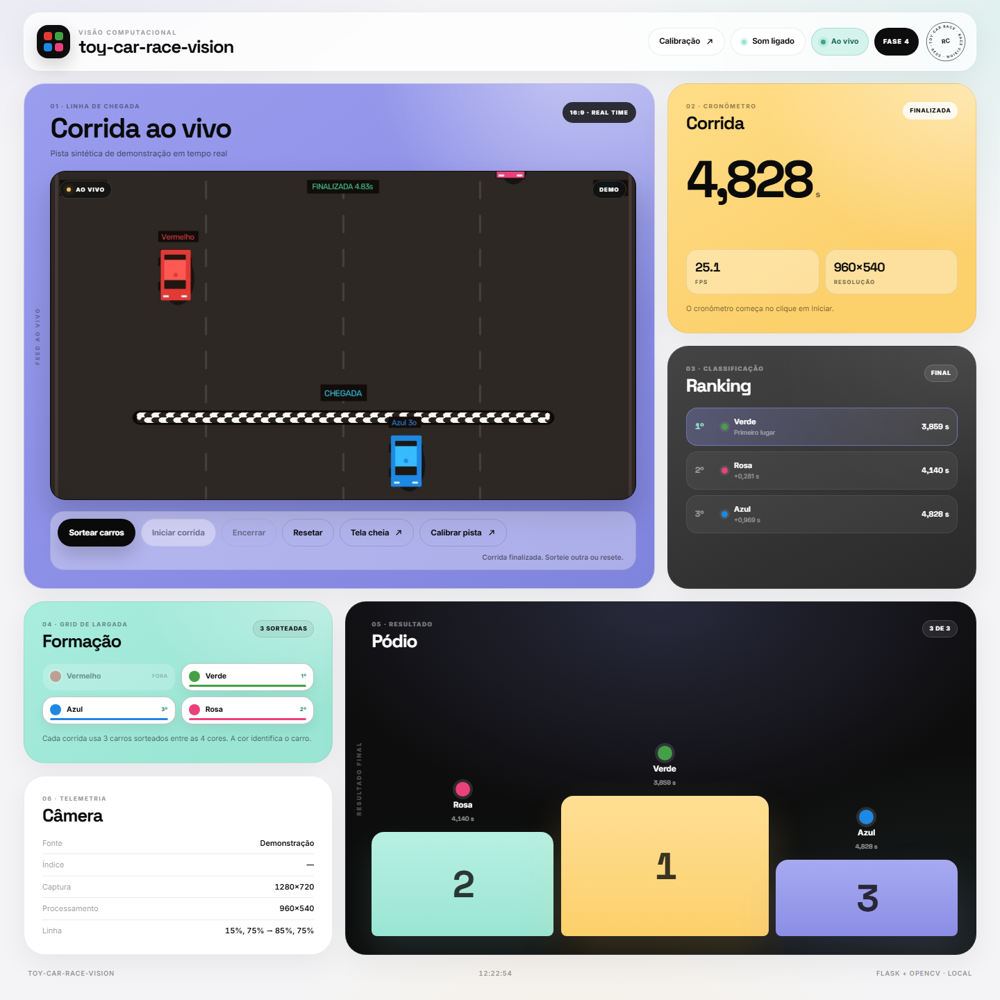

# toy-car-race-vision

Reconhecimento de carrinhos de brinquedo por webcam na linha de chegada. O sistema identifica a cor de cada carro, registra a ordem de chegada, o tempo de cada um e exibe o ranking em uma interface local.



## Status

**Fase 4 concluída** — captura, servidor, interface ao vivo, calibração, detecção por cor, sorteio de 3 carros, cruzamento da linha, ranking, tempos, pódio animado, som de chegada, progresso por carro, tela cheia e layout responsivo. A tela principal foi redesenhada em Bento Grid claro, com tipografia self-hosted e suporte a movimento reduzido. A próxima etapa é a suíte de testes, o checklist com webcam real e a publicação (Fase 5).

## Como funciona

- A webcam fica na **linha de chegada**, em ângulo diagonal elevado, com fundo neutro.
- Os carros têm cor sólida predominante: **vermelho, verde, azul e rosa**.
- Cada corrida usa **3 carros sorteados** entre as 4 cores. A cor identifica o carro.
- Uma fita na pista marca a linha de chegada, calibrada com 2 cliques na tela de setup.
- O botão **Iniciar** registra o t0. A ordem real de cruzamento define o ranking.
- A interface mostra vídeo ao vivo, cronômetro, tempo de chegada, diferença para o 1º lugar, progresso por carro e pódio animado; o som de chegada pode ser desligado no topo da página.

> Como a câmera vê apenas a chegada, o tempo é contado a partir do clique em "Iniciar" e representa uma estimativa da prova, não um cronômetro oficial de largada.

## O que já funciona

- Vídeo ao vivo da webcam via MJPEG, com overlay da linha de chegada e da área de interesse.
- Interface responsiva em Bento Grid claro, com status da câmera, FPS, resolução e informações da linha.
- Tipografia Space Grotesk/Inter self-hosted, selo circular, cartões com tilt sutil, botões magnéticos e animações com suporte a `prefers-reduced-motion`.
- Tela `/setup` para calibrar a linha com 2 cliques e a ROI com 2 cantos, direto no navegador.
- Ferramenta `tools/calibrate.py` para ajuste fino das faixas HSV, com máscara, FPS e área dos blobs.
- Detecção das 4 cores por ROI, HSV, morfologia e maior contorno, com área mínima configurável.
- Sorteio de 3 cores sem repetição, formação na interface e máquina de estados `idle -> armed -> running -> finished`.
- Cruzamento da linha com confirmação em vários frames, uma chegada por cor, ranking, tempo de chegada e diferença para o 1º.
- Controles de sortear, iniciar, encerrar, resetar e tela cheia, com cronômetro ao vivo e ranking atualizado por polling.
- Progresso por carro na formação, calculado pela aproximação do centroide à linha de chegada.
- Pódio animado com até 3 finalistas, som sintetizado por chegada e fanfarra ao encerrar a corrida.
- Layout responsivo para desktop, tablet e celular, com preferência de som persistida no navegador.
- API local de estado, configuração e corrida (`/api/state`, `/api/config`, `/api/race/*`, `/api/health`).
- Configuração em `config.example.json` + `config.local.json`, com merge recursivo e recarga automática.
- Modo de demonstração (`--demo`) para testar a interface sem webcam.
- Tratamento de câmera indisponível sem derrubar o servidor.

## Stack

- Python 3.10
- OpenCV 5 (captura e visão computacional)
- Flask 3 (servidor local)
- NumPy
- HTML, CSS e JavaScript puro (sem Node, React ou frameworks de front-end)

## Estrutura do repositório

```text
toy-car-race-vision/
|-- README.md
|-- LICENSE
|-- .gitignore
|-- requirements.txt
|-- config.example.json       # configuração versionada (padrões)
|-- config.local.json         # calibração do usuário (ignorado pelo git)
|-- app.py                    # servidor Flask e API local
|-- src/
|   |-- camera.py             # captura em thread, modo demo e último frame
|   |-- overlay.py            # linha de chegada, ROI, detecções e HUD no vídeo
|   |-- detection.py          # máscaras HSV, contornos e classificação por cor
|   |-- race.py               # estado da corrida, chegadas, ranking e tempos
|   |-- geometry.py           # linha, lado e cruzamento
|   |-- pipeline.py           # liga captura, detecção, corrida e API
|   `-- config.py             # carregamento, validação e persistência
|-- templates/
|   |-- index.html            # interface principal
|   `-- setup.html            # calibração da linha, da ROI e diagnóstico
|-- static/
|   |-- css/style.css
|   |-- css/setup.css
|   |-- fonts/                # Space Grotesk e Inter self-hosted + licenças
|   |-- js/app.js
|   |-- js/setup.js
|   `-- img/                  # favicon e prévia da interface
|-- tools/
|   `-- calibrate.py          # ajuste fino das faixas HSV com sliders
|-- tests/                    # testes automatizados (fase 5)
`-- Journal/
    |-- README.md
    |-- diario/
    |-- especificacao.md
    |-- arquitetura.md
    |-- adr/
    `-- backlog.md
```

A Fase 4 está implementada: o pipeline processa cada frame na thread da câmera, a interface controla o sorteio e a corrida, e o ranking, o progresso e o pódio são atualizados em tempo real. O som usa WebAudio sem arquivos externos, e a tela cheia usa a API nativa do navegador. A tela principal usa um Bento Grid claro com fontes locais; a tela de setup mantém o tema escuro por enquanto.

## Instalação e execução

Requisitos: Windows 10/11, Python 3.10+ e uma webcam.

```powershell
python -m venv .venv
.\.venv\Scripts\Activate.ps1
pip install -r requirements.txt
python app.py
```

Depois acesse <http://127.0.0.1:5000>. O servidor escuta apenas em localhost.

Para testar a interface sem webcam, use a pista sintética:

```powershell
python app.py --demo
```

Opções úteis: `--camera-index 1` para escolher outra câmera, `--port 5055` para trocar a porta e `--debug` para depuração.

Para uma corrida, clique em **Sortear carros**, posicione os carrinhos na pista e clique em **Iniciar corrida** no momento da largada. O cronômetro começa no clique, as chegadas entram no ranking automaticamente e **Encerrar** finaliza a bateria se algum carro não cruzar a linha. **Resetar** limpa o resultado para a próxima corrida.

Com o servidor rodando, abra <http://127.0.0.1:5000/setup> ou clique em **Calibração** para ajustar a linha de chegada e a área de interesse. As alterações são gravadas em `config.local.json` e aplicadas sem reiniciar o servidor.

Para calibrar as cores, pare o servidor e execute a ferramenta com a webcam:

```powershell
python tools/calibrate.py
```

Use as teclas **1-4** para trocar de cor, clique na imagem para amostrar um tom, ajuste os sliders e pressione **s** para salvar. O parâmetro `--demo` abre a pista sintética para testar a ferramenta sem webcam.

## Roadmap

- [x] Fase 0 — estrutura do repositório e documentação
- [x] Fase 1 — captura da webcam e servidor local
- [x] Fase 2 — calibração da linha, da ROI e das cores
- [x] Fase 3 — detecção, ranking e tempos
- [x] Fase 4 — pódio, som, progresso, tela cheia e responsividade
- [x] Extra — redesign da tela principal em Bento Grid claro
- [ ] Fase 5 — testes, documentação final e publicação

## Documentação

Toda a documentação de projeto está em [`Journal/`](Journal/README.md):

- [Especificação](Journal/especificacao.md)
- [Arquitetura](Journal/arquitetura.md)
- [Decisões técnicas (ADRs)](Journal/adr/)
- [Diário de bordo](Journal/diario/)
- [Backlog](Journal/backlog.md)

## Licença

MIT — veja [LICENSE](LICENSE).
